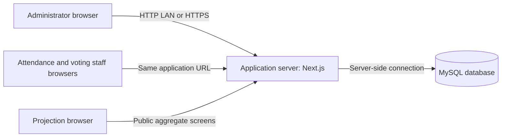

# Lucy Voting system documentation

Start here when installing the system on another server or helping staff use it from other devices. These guides describe the checked-in application and migration history as reviewed on **11 November 2026**.

## Choose your starting point

| What you need to do | Read |
| --- | --- |
| Install the application and MySQL on a new Windows server | [Installation](installation.md) |
| Prepare a Linux application server | [Installation: Ubuntu/Debian](installation.md#ubuntudebian-server-equivalent) and [Deployment](deployment.md) |
| Serve a production build to other computers on the LAN | [Deployment](deployment.md) |
| Set up automatic startup or an HTTPS reverse proxy | [Deployment](deployment.md) |
| Understand `.env`, browser URLs, database connections, and ports | [Configuration reference](configuration.md) |
| Add staff accounts and run the meeting/election workflow | [User guide](user-guide.md) |
| Back up, restore, update, or move the server | [Operations](operations.md) |
| Diagnose login, network, database, printing, or ballot problems | [Troubleshooting](troubleshooting.md) |
| Understand separate ballots for represented shareholders | [Independent shareholder ballots](independent-shareholder-ballots.md) |
| Train staff using slides, a printable manual, and example exports | [Training package](#training-materials) |

Read **Installation → Deployment → User guide** for a new installation. Read **Operations** before changing an existing database or moving an established system.

## How devices connect

One server runs Node.js/Next.js and connects to MySQL. MySQL can run on that server or a separately configured database server. Staff computers, tablets, and projection computers use a current web browser; they do not need Node.js, npm, application source, or MySQL installed.

Keep all devices connected to the same authoritative installation. Installing the app with a new empty database creates a separate system and does not copy existing shareholders, accounts, or elections.

## Installation examples

The guides use these replaceable values:

| Item | Example |
| --- | --- |
| Windows application folder | `C:\Voting\voting-app` |
| Linux application folder | `/opt/voting-app` |
| MySQL database | `votingdb` |
| Dedicated local MySQL account | `voting_app` |
| Direct LAN address | `http://172.18.10.125:3000` |
| HTTPS address | `https://voting.example.com` |

Use your server's actual IP/DNS name, credentials, and paths. Example passwords are placeholders; there is no built-in default administrator password. First-admin setup creates the account you specify and gives it a generated temporary password.

Node.js 24 LTS is the recommended runtime for this source distribution. The current schema/migrations target MySQL, and the historical SQL requires `lower_case_table_names=1` on a fresh migration target. Read the installation prerequisites before provisioning a Linux MySQL instance.

For direct LAN production, set `AUTH_ORIGIN` to the exact browser URL, including `http://` and port. Production builds support HTTP LAN session cookies; HTTPS uses secure cookies. All staff, including users on the server computer, should use the same configured address.

## Handover checklist

- [ ] Source release, locked dependencies, configuration, and database setup are recorded.
- [ ] Database migrations and Prisma client generation completed successfully.
- [ ] First administrator changed the generated temporary password.
- [ ] Production build starts automatically using the intended application folder.
- [ ] Another computer can sign in and reload a protected page.
- [ ] Roles and meeting assignments are correct for staff.
- [ ] Shareholder import, attendance, separate paper cards, and voting were rehearsed with fictional data in a separate installation.
- [ ] Printer and projector are tested from the devices that will actually use them.
- [ ] A backup and a successful restore test are recorded.
- [ ] Staff know the application URL, administrator contact, and where to find this documentation.

## Training materials

Existing training files remain in [training](training/). They complement the text guides:

- [Trainer guide](training/Trainer_Guide.md): workshop preparation, role-specific learning paths, and demonstration checkpoints.
- [PowerPoint training](training/Lucy_Voting_User_Training.pptx): editable presentation with trainer notes.
- [PDF user manual](training/Lucy_Voting_User_Manual.pdf): printable manual.
- [Complete training archive](training/Lucy_Voting_Training_Package.zip): training package and example files.
- [Shareholder import example template](training/examples/Shareholder_Import_Template.xlsx).
- [Standard voting-card example](training/examples/Standard_Voting_Cards_Example.pdf).
- [Grouped voting-card example](training/examples/Grouped_Voting_Cards_Example.pdf).
- [Attendance report example](training/examples/Attendance_Report_Example.pdf).
- [Full voting report example](training/examples/Full_Voting_Report_Example.xlsx).

The training records are fictional. Download the current import template and reports from the application when doing real work. Deployment and configuration details in the new text guides cover the production HTTP LAN sign-in fix.

## Keeping the guides with the installation

Include the complete `docs` folder in the source package sent to a new server. Markdown files can be read in an editor or repository viewer; the PDF manual is convenient on client devices. Keep secrets, live database dumps, and temporary administrator credentials separate from the shared documentation.

Return to the [project overview](../README.md) for features and development context.
